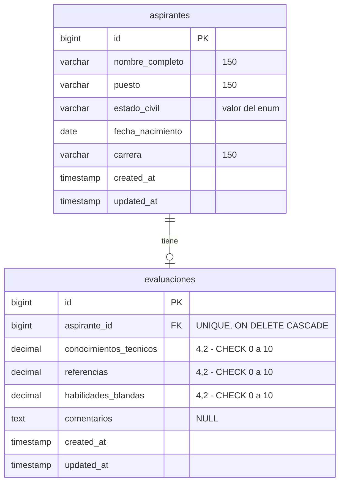

# Decisiones técnicas

## 1. Tecnologías y versiones

| Tecnología | Versión | Por qué |
|---|---|---|
| PHP | 8.5 | Versión con soporte activo; existe la imagen oficial `php:8.5-apache`. |
| Laravel | 13 | Versión con soporte activo (Laravel 12 solo recibe parches de seguridad). Compatible con PHP 8.3 a 8.5. |
| MySQL | 8.4 LTS | Versión de soporte extendido; admite restricciones `CHECK`. |
| Apache | 2.4 (imagen oficial de PHP) | Ejecuta PHP como módulo; configuración mínima con `mod_rewrite`. |
| Bootstrap | 5.3 (CDN) | Interfaz limpia y responsiva sin escribir CSS desde cero. Se carga por CDN con versión fija y `integrity`, así el contenedor no necesita Node ni Vite. |
| Flatpickr | 4.6 (CDN) | El campo `type="date"` muestra el formato según el idioma del navegador; Flatpickr muestra siempre `dd/mm/aaaa` y envía `aaaa-mm-dd` al servidor. Si no carga, el campo nativo sigue funcionando. |
| PHPUnit | 12 | Incluido en Laravel. Pruebas de feature con SQLite en memoria. |
| laravel-lang/common | dev | Solo para generar `lang/es/`; los archivos se versionan y el paquete no se instala en producción. |

## 2. Supuestos

El enunciado no define estos puntos; se tomaron estas decisiones:

1. **Una evaluación por aspirante.** Se crea y después se edita. Relación uno a uno con restricción `UNIQUE` en `evaluaciones.aspirante_id`.
2. **Sin autenticación.** Acceso directo a todas las pantallas (ver sección 6).
3. **Estado civil** como catálogo cerrado: enum de PHP `App\Enums\EstadoCivil` (Soltero/a, Casado/a, Unión libre, Divorciado/a, Viudo/a, Separado/a), validado con `Rule::enum`. En la base se guarda el valor (`union_libre`) y en pantalla la etiqueta (`Unión libre`).
4. **Puesto** como texto libre, porque el enunciado pide "nombre del puesto".
5. **Nombre completo** en un solo campo, como lo pide el enunciado.
6. **Calificaciones** `decimal(4,2)`, de 0 a 10 inclusive, con hasta dos decimales. Se validan en el servidor (`numeric`, `between:0,10`, `decimal:0,2`) y en el formulario (`type="number" min="0" max="10" step="0.01"`).
7. **Fecha de nacimiento** anterior a hoy.
8. **Promedio** simple de las tres calificaciones, redondeado a dos decimales. Es un dato informativo calculado en el modelo; no se guarda en la base.
9. **Listado** paginado de 10 en 10, con búsqueda por nombre o puesto (coincidencia parcial, sin distinguir mayúsculas).
10. **Comentarios** opcionales, hasta 5,000 caracteres.
11. **Edición de los datos del aspirante** desde su detalle, para corregir errores de captura. Usa el mismo formulario y las mismas reglas que el alta.

## 3. Modelo de datos

- **Uno a cero-o-uno**: un aspirante puede no tener evaluación todavía. La restricción `UNIQUE` en `aspirante_id` impide una segunda evaluación, incluso con peticiones simultáneas que la validación de PHP no alcanzaría a detectar.
- **`ON DELETE CASCADE`**: si en el futuro se borra un aspirante, su evaluación se borra con él y no quedan registros huérfanos.
- **`decimal` y no `float`**: `decimal` guarda el valor exacto (`8.75`); `float` lo aproxima en binario.
- **Restricciones `CHECK`** de 0 a 10 en MySQL, además de la validación de la aplicación. Se agregan solo en MySQL/MariaDB porque SQLite (usado en las pruebas) no permite agregarlas con `ALTER TABLE`.
- **Sin índices en `nombre_completo` ni `puesto`**: la búsqueda usa `LIKE '%texto%'`, que no aprovecha un índice B-tree. Con el volumen esperado la búsqueda es inmediata; si creciera mucho, se usaría un índice `FULLTEXT`.
- Las tablas `users`, `sessions`, `cache` y `jobs` vienen con Laravel. `sessions` y `cache` se usan (sesiones y caché en base de datos); `users` queda lista para una futura autenticación.

## 4. Organización del código

- **Controladores delgados**: solo coordinan; la validación vive en Form Requests y el acceso a datos en Eloquent.
- **Form Requests** (`StoreAspiranteRequest`, `StoreEvaluacionRequest`) con mensajes y nombres de campo en español. Se usa `bail` en las calificaciones para mostrar un solo error por campo. El aspirante y la evaluación usan el mismo Request al crear y al editar, porque las reglas son idénticas; los formularios también se comparten (`_form.blade.php`).
- **Route model binding**: `{aspirante}` en la URL se convierte en el modelo; si no existe, responde 404.
- **Ruta singleton** para la evaluación (`/aspirantes/{aspirante}/evaluacion`): refleja que cada aspirante tiene una sola, sin exponer el id de la evaluación.
- **Carga anticipada** con `with('evaluacion')` en el listado para evitar el problema N+1 (siempre 2 consultas por página en lugar de 1 + N).
- **Orden determinista** del listado: `created_at DESC, id DESC`. Sin el desempate por `id`, los registros creados en el mismo segundo podían repetirse o perderse entre páginas.
- **Patrón Post/Redirect/Get**: después de guardar se redirige al detalle con un mensaje flash, para que recargar la página no reenvíe el formulario.
- **Sin transacciones explícitas**: cada operación escribe en una sola tabla con una sola instrucción, que en InnoDB ya es atómica. Se usaría `DB::transaction()` si una acción escribiera en varias tablas (por ejemplo, registrar aspirante y evaluación juntos).
- **Seeder sin factories**: en Docker se instala sin dependencias de desarrollo y Faker no está disponible, así que el seeder usa datos fijos. Las factories se usan solo en las pruebas.

## 5. Seguridad y manejo de errores

- **CSRF**: `@csrf` en todos los formularios; una petición sin token válido responde 419 con una página propia.
- **XSS**: toda la salida usa `{{ }}`, que escapa el HTML. Los saltos de línea de los comentarios se respetan con CSS (`white-space: pre-line`) en lugar de imprimir HTML sin escapar. Hay una prueba que lo verifica.
- **Asignación masiva**: `$fillable` en los modelos y `$request->validated()` en los controladores; nunca `$request->all()`.
- **Inyección SQL**: solo Eloquent y parámetros preparados, incluida la búsqueda.
- **Validación en dos capas**: en el navegador (comodidad) y en el servidor (la que garantiza los datos), más las restricciones `UNIQUE` y `CHECK` en la base.
- **Páginas de error propias** en español (404, 419 y 500). Usan una plantilla independiente del layout principal para poder mostrarse aunque la aplicación falle.
- **`APP_DEBUG=false`** en Docker: el usuario no ve detalles internos; el error completo va al log (`docker compose logs app`).
- **Sin secretos en el repositorio**: `.env` está en `.gitignore`; la `APP_KEY` se genera al primer arranque. Las credenciales de MySQL tienen valores por defecto para que funcione sin configuración y se pueden cambiar con variables de entorno sin tocar el código. La `APP_KEY` de `phpunit.xml` es solo para pruebas.
- **Docker**: `DocumentRoot` en `public/`, de modo que el código y la configuración no son accesibles desde el navegador; `php.ini` de producción; la imagen final no incluye Composer ni dependencias de desarrollo.

## 6. Docker

- **`Dockerfile` multietapa**: la etapa `composer:2` instala las dependencias de producción; la etapa `php:8.5-apache` copia solo el resultado. Copiar primero `composer.json` y `composer.lock` aprovecha la caché de capas.
- **`compose.yaml`**: `app` espera a que `db` esté *healthy*. El healthcheck usa `127.0.0.1` (TCP) para no dar por lista a la base durante su inicialización, cuando MySQL levanta un servidor temporal sin red. Los datos persisten en el volumen `mysql-data`.
- **`docker/entrypoint.sh`**: genera la `APP_KEY` si falta, aplica las migraciones (`migrate --force`), guarda en caché configuración, rutas y vistas (`optimize`) y arranca Apache como proceso principal.

## 7. Qué quedó fuera y cómo se haría después

| Pendiente | Cómo se haría |
|---|---|
| Autenticación y roles | Laravel Breeze o Fortify para el login; Policies o Gates para restringir quién evalúa. Proteger las rutas con el middleware `auth`. |
| Borrado de aspirantes | Acción `destroy` con confirmación. La base ya borra la evaluación en cascada; se podría usar `SoftDeletes` para conservar historial. |
| Catálogo de vacantes | Tabla `vacantes` con llave foránea en `aspirantes`, para normalizar el puesto y evitar variantes de escritura. |
| Exportaciones | Exportar el listado a CSV o Excel (por ejemplo, con `maatwebsite/excel`). |
| Búsqueda a gran escala | Índice `FULLTEXT` en nombre y puesto. |
